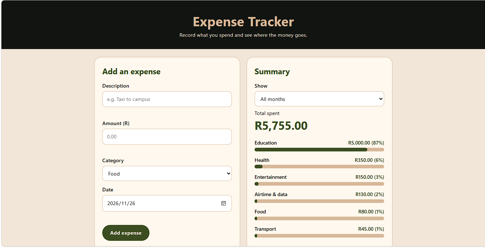
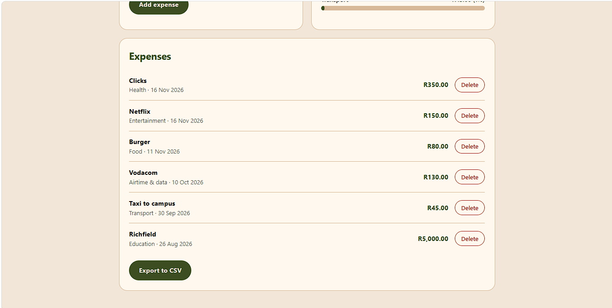

# Expense Tracker

A responsive expense tracker built with plain HTML, CSS and JavaScript. Record what you spend, see where the money goes, and export your data to a spreadsheet.


**[Try the live demo](https://agi07.github.io/expense-tracker/)**




## Features

- Add expenses with a description, amount, category and date
- Clear validation messages for every field
- Data is saved in your browser, so it is still there after you close the page
- Category breakdown with percentage bars
- Filter by month, and the total and breakdown follow the filter
- Export the current view to CSV for Excel or Google Sheets
- Works on phones and desktops
- No frameworks, no build step, nothing to install

## Security and quality decisions

| Risk | How this project handles it |
|---|---|
| Cross-site scripting (XSS) | Everything typed by the user is shown with `textContent`, never `innerHTML`, so typed HTML or scripts cannot run. |
| Invalid input | Every field is validated: amounts must be positive with at most two decimals and no more than R1,000,000, and dates cannot be in the future. |
| Tampered saved data | Data loaded from the browser's storage is treated as untrusted. Every entry is checked, and broken or modified entries are ignored instead of crashing the app. |
| CSV injection | Text that starts with `=`, `+`, `-` or `@` gets a leading apostrophe in the export, so a spreadsheet cannot run it as a formula. Commas, quotes and line breaks are quoted correctly. |
| Rounding errors | Money is stored as whole cents, not decimals, to avoid errors like 0.1 + 0.2 = 0.30000000000000004. |

## How to run

No installation needed. Download or clone the repo and open `index.html` in a browser.

```
git clone https://github.com/Agi07/expense-tracker.git
```

For automatic reloading while editing, use the Live Server extension in VS Code.

## Run the tests

Requires Node.js 18 or newer.

```
npm test
```

There are 28 automated tests covering validation, money handling, filtering, totals, saved-data checks and the CSV export. They also run automatically on GitHub for every push.

## Project structure

```
index.html        page structure
css/style.css     styling
js/logic.js       rules and calculations (no page code, so it can be tested)
js/app.js         connects the logic to the page
logic.test.js     automated tests
```

## Limitations

- **Data lives only in your browser.** Clearing the browser's site data deletes it, and it does not sync between devices. Use Export to CSV to keep a backup.
- There are no user accounts, and nobody else can see your data.
- There is no edit button. To change an expense, delete it and add it again.
- The categories are fixed, and amounts are in South African rand only.
- The tests cover the logic, but not the page itself. There are no automated browser tests.
- A description that starts with `-` gets an apostrophe in the CSV file. This is a deliberate safety trade-off.

## What I learned

How to separate logic from page code so it can be tested, why user input and stored data must never be trusted, how XSS and CSV injection work and how to prevent them, why money should be stored in whole cents, and how to set up automatic testing with GitHub Actions.

Built by Moagi Makhudu, BSc Information Technology student.